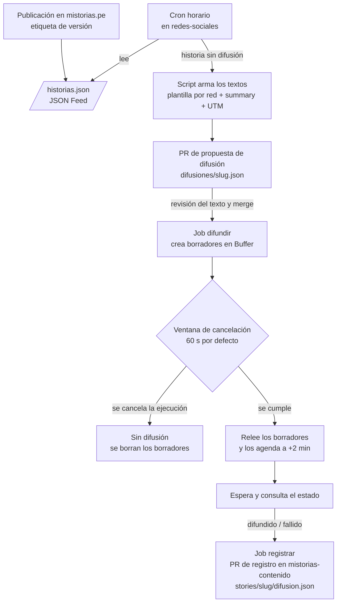

# mistorias-redes-sociales

Plantillas, calendario editorial y seguimiento de la ejecución semanal de redes
sociales de Mistorias (Facebook, Instagram y X).

La estrategia y los criterios editoriales (audiencia, tono, qué se le pide al
lector) están definidos en
[`redes-sociales-plan.md`](https://github.com/mistorias/mistorias-esencia-de-marca/blob/main/redes-sociales-plan.md),
en el repo `mistorias-esencia-de-marca`. Este repo aloja la ejecución: lo que se
usa para difundir. No guarda el registro de qué salió efectivamente en cada red:
eso vive en `mistorias-contenido`, junto a cada historia.

Para contribuir, ver [CONTRIBUTING.md](CONTRIBUTING.md) y los estándares en
[docs/STANDARDS.md](docs/STANDARDS.md) y [docs/IDIOMA.md](docs/IDIOMA.md).

## Decisiones arquitecturales (ADR)

Las decisiones sobre cómo se construye y con qué herramientas se opera este repo
viven en [`docs/adr/`](docs/adr/README.md), no en este README.

## Cómo se difunde una historia

Sin IA, con una revisión del texto y una autoaprobación con ventana de
cancelación. El detalle y el porqué están en el
[ADR 0003](docs/adr/0003-flujo-de-difusion-automatica.md); las credenciales, en
el [ADR 0004](docs/adr/0004-credenciales-y-minimo-privilegio.md); el vocabulario
(difusión, borrador, autoaprobación), en [CONTEXT.md](CONTEXT.md).

1. Cuando una historia se publica en mistorias.pe, un cron de este repo la
   detecta en el feed del sitio.
2. Un script arma el texto de cada red con su plantilla y abre el **PR de
   propuesta de difusión**. Ahí se revisa el texto y, si hace falta, se corrige.
   Hacerlo disponible es el único acto humano; nunca se fusiona solo.
3. Se crea un **borrador** por red en Buffer y corre la **ventana de
   cancelación**. Para frenar la difusión, cancela la ejecución en Actions
   (_Cancel workflow_ o `gh run cancel`): no sale nada.
4. Si no cancelas, los borradores se agendan dos minutos después. El job
   consulta si ya salieron y abre el **PR de registro** en
   `mistorias-contenido`.

La ventana dura 60 segundos. Se cambia con la variable de repositorio
`BROADCAST_CANCEL_WINDOW_SECONDS` (entero entre 10 y 3600).

Cada pieza recibe solo el permiso que su tarea necesita (principio de mínimo
privilegio): una credencial por job, cada una en su propio environment. El cron
no ve la llave de Buffer, el job que difunde no puede abrir PRs, y las dos
GitHub Apps son distintas entre sí y de la que actualiza el contenido en
mistorias-web.

## Pendiente de ejecución

Hecho: cuenta de Buffer creada, con Facebook, Instagram y X conectados (detalle
en el [ADR 0001](docs/adr/0001-herramienta-publicacion-buffer.md)).

Primero, el
[spike #11](https://github.com/mistorias/mistorias-redes-sociales/issues/11):
confirma con la API de Buffer el paso de borrador a cola, las llaves de solo
lectura y los límites reales.

Manual, requiere login de Mistorias. En GitHub, cada environment admite
despliegues solo desde `main`:

- Generar una **Personal Access** key en Buffer (no un App Client) y guardarla
  como secret `BUFFER_API_KEY` del environment `buffer`.
- Si el spike confirma que existe: generar una segunda llave de solo lectura y
  guardarla como `BUFFER_READ_ONLY_API_KEY` en el environment `buffer-lectura`.
- Crear la GitHub App **propuestas**, instalarla solo en este repo con
  `contents: write` y `pull_requests: write`, y guardar
  `SOCIAL_PROPOSALS_BOT_CLIENT_ID` (variable) y
  `SOCIAL_PROPOSALS_BOT_PRIVATE_KEY` (secret) en el environment `propuestas`.
- Crear la GitHub App **registro**, instalarla solo en `mistorias-contenido` con
  los mismos permisos, y guardar `SOCIAL_RECORD_BOT_CLIENT_ID` (variable) y
  `SOCIAL_RECORD_BOT_PRIVATE_KEY` (secret) en el environment `registro`.
- Opcional: definir `BROADCAST_CANCEL_WINDOW_SECONDS` si 60 segundos no alcanza.
- Quitar el skill `publicar-en-redes` de la cuenta de Claude: lo reemplaza este
  flujo.

Antes del primer registro, en mistorias-web: publicar `/historias.json` y
ampliar el gate de carpetas de historia para que acepte `difusion.json`.

Siguiente tarea de código: las plantillas por red, el script que arma los
textos, los jobs `proponer`, `difundir` y `registrar`, y sus tests de
integración
([ADR 0005](docs/adr/0005-tests-de-integracion-con-servidor-falso.md)).

## Qué va a haber aquí

- **Plantillas por red** — el texto fijo de cada red (gancho = `summary`, cierre
  particular, enlace con UTM), descrito en la sección 8 del plan. El script las
  llena; ya no se copian a mano.
- **`difusiones/`** — una propuesta de difusión por historia, `<slug>.json`, que
  entra por su PR.
- **Calendario editorial** — qué historia se publica cada semana y en qué fecha.
- **Lineamientos de moderación de comentarios** — cuando se definan (pendiente
  13.2 del plan).
- **`docs/adr/`** — decisiones arquitecturales de este repo (ver arriba).
- **Integración con Buffer** — scripts de difusión vía API (ver arriba).
