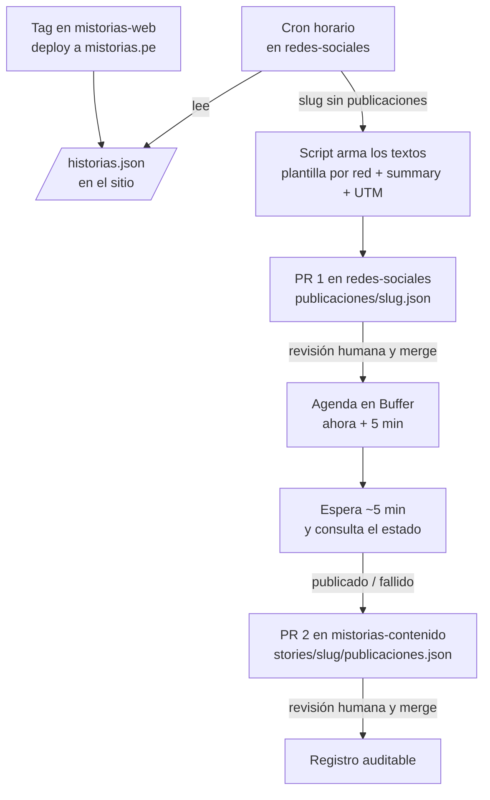

# mistorias-redes-sociales

Plantillas, calendario editorial y seguimiento de la ejecución semanal de redes
sociales de Mistorias (Facebook, Instagram y X).

La estrategia y los criterios editoriales (audiencia, tono, qué se le pide al
lector) están definidos en
[`redes-sociales-plan.md`](https://github.com/mistorias/mistorias-esencia-de-marca/blob/main/redes-sociales-plan.md),
en el repo `mistorias-esencia-de-marca`. Este repo aloja la ejecución: lo que se
usa para publicar. No guarda el registro de qué salió efectivamente en cada red:
eso vive en `mistorias-contenido`, junto a cada historia.

Para contribuir, ver [CONTRIBUTING.md](CONTRIBUTING.md) y los estándares en
[docs/STANDARDS.md](docs/STANDARDS.md) y [docs/IDIOMA.md](docs/IDIOMA.md).

## Decisiones arquitecturales (ADR)

Las decisiones sobre cómo se construye y con qué herramientas se opera este repo
viven en [`docs/adr/`](docs/adr/README.md), no en este README.

## Cómo se publica una historia

Sin IA y con dos revisiones humanas. El detalle y el porqué están en el
[ADR 0003](docs/adr/0003-flujo-de-publicacion-automatica.md); las credenciales,
en el [ADR 0004](docs/adr/0004-credenciales-y-minimo-privilegio.md).

1. Cuando una historia nueva aparece en mistorias.pe, un cron de este repo la
   detecta en el feed del sitio.
2. Un script arma el texto de cada red con su plantilla y abre el **PR 1**. Ahí
   se revisa y, si hace falta, se corrige.
3. Al fusionar el PR 1, los posts se agendan en Buffer para cinco minutos
   después.
4. Pasado ese tiempo, el job consulta si ya salieron y abre el **PR 2** en
   `mistorias-contenido` con el registro de lo publicado.

Cada pieza recibe solo el permiso que su tarea necesita (principio de mínimo
privilegio): la llave de Buffer la ve solo el job que agenda, y el bot que abre
los PRs es una GitHub App propia, distinta de la que actualiza el contenido en
mistorias-web.

## Pendiente de ejecución

Hecho: cuenta de Buffer creada, con Facebook, Instagram y X conectados (detalle
en el [ADR 0001](docs/adr/0001-herramienta-publicacion-buffer.md)).

Manual, requiere login de Mistorias:

- Generar una **Personal Access** key en Buffer (no un App Client) y confirmar
  los límites del plan gratuito que cita el ADR 0004.
- Crear el _environment_ `buffer` en este repo y guardar la llave como secret
  `BUFFER_API_KEY`.
- Crear la GitHub App del bot de redes, instalarla solo en este repo y en
  `mistorias-contenido` con `contents: write` y `pull_requests: write`, y
  guardar `SOCIAL_BOT_CLIENT_ID` (variable) y `SOCIAL_BOT_PRIVATE_KEY` (secret).
- Quitar el skill `publicar-en-redes` de la cuenta de Claude: lo reemplaza este
  flujo.

Antes del primer registro, en mistorias-web: publicar `/historias.json` y
ampliar el gate de carpetas de historia para que acepte `publicaciones.json`.

Siguiente tarea de código: las plantillas por red, el script que arma los
textos, el de agendar y confirmar en Buffer, y sus tests de integración
([ADR 0005](docs/adr/0005-tests-de-integracion-con-servidor-falso.md)).

## Qué va a haber aquí

- **Plantillas por red** — el texto fijo de cada red (gancho = `summary`, cierre
  particular, enlace con UTM), descrito en la sección 8 del plan. El script las
  llena; ya no se copian a mano.
- **`publicaciones/`** — un borrador por historia, `<slug>.json`, que entra por
  el PR 1.
- **Calendario editorial** — qué historia se publica cada semana y en qué fecha.
- **Lineamientos de moderación de comentarios** — cuando se definan (pendiente
  13.2 del plan).
- **`docs/adr/`** — decisiones arquitecturales de este repo (ver arriba).
- **Integración con Buffer** — scripts de publicación vía API (ver arriba).
