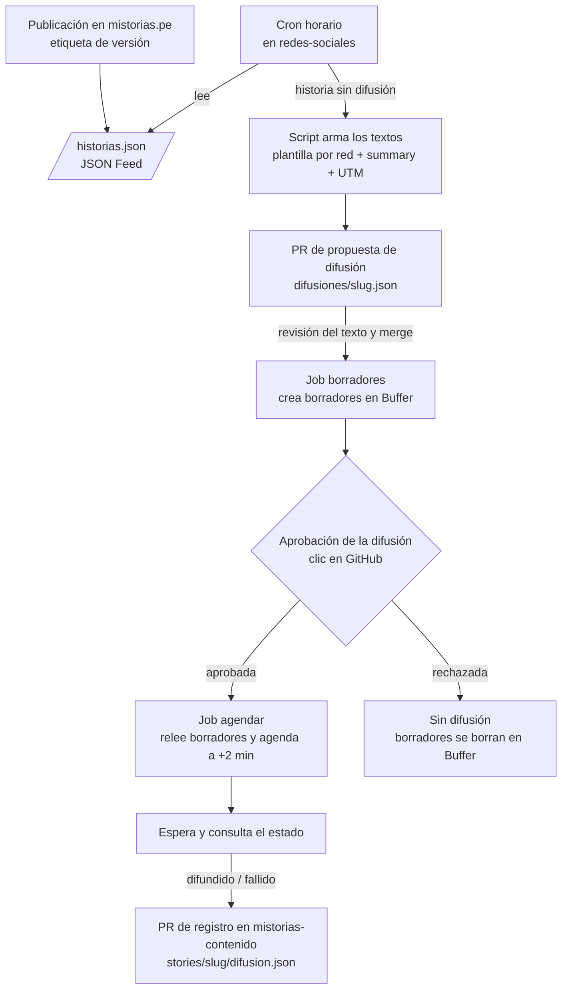

# mistorias-redes-sociales

Plantillas, calendario editorial y seguimiento de la ejecución semanal de redes
sociales de Mistorias (Facebook, Instagram y X).

La estrategia y los criterios editoriales (audiencia, tono, qué se le pide al
lector) están definidos en
[`redes-sociales-plan.md`](https://github.com/mistorias/mistorias-esencia-de-marca/blob/main/redes-sociales-plan.md),
en el repo `mistorias-esencia-de-marca`. Este repo aloja la ejecución: lo que se
usa para difundir. No guarda el registro de qué salió efectivamente en cada red:
eso vive en `mistorias-contenido`, junto a cada historia.

Para contribuir, ver [CONTRIBUTING.md](CONTRIBUTING.md) y los estándares en
[docs/STANDARDS.md](docs/STANDARDS.md) y [docs/IDIOMA.md](docs/IDIOMA.md).

## Decisiones arquitecturales (ADR)

Las decisiones sobre cómo se construye y con qué herramientas se opera este repo
viven en [`docs/adr/`](docs/adr/README.md), no en este README.

## Cómo se difunde una historia

Sin IA, con una revisión del texto y una aprobación aparte. El detalle y el
porqué están en el [ADR 0003](docs/adr/0003-flujo-de-difusion-automatica.md);
las credenciales, en el
[ADR 0004](docs/adr/0004-credenciales-y-minimo-privilegio.md); el vocabulario
(difusión, borrador, aprobación), en [CONTEXT.md](CONTEXT.md).

1. Cuando una historia se publica en mistorias.pe, un cron de este repo la
   detecta en el feed del sitio.
2. Un script arma el texto de cada red con su plantilla y abre el **PR de
   propuesta de difusión**. Ahí se revisa el texto y, si hace falta, se corrige.
3. Hacer disponible ese PR crea un **borrador** por red en Buffer. Todavía no
   sale nada.
4. **Aprobación de la difusión:** revisas los borradores en Buffer y das clic en
   _Approve deployment_ en GitHub. Si no apruebas, no se difunde.
5. Los borradores pasan a agendados dos minutos después. El job consulta si ya
   salieron y abre el **PR de registro** en `mistorias-contenido`.

Cada pieza recibe solo el permiso que su tarea necesita (principio de mínimo
privilegio): la llave de Buffer la ven solo los jobs que crean y agendan los
borradores, la aprobación vive en un environment sin secretos, y el bot que abre
los PRs es una GitHub App propia, distinta de la que actualiza el contenido en
mistorias-web.

## Pendiente de ejecución

Hecho: cuenta de Buffer creada, con Facebook, Instagram y X conectados (detalle
en el [ADR 0001](docs/adr/0001-herramienta-publicacion-buffer.md)).

Manual, requiere login de Mistorias:

- Generar una **Personal Access** key en Buffer (no un App Client) y confirmar
  los límites del plan gratuito que cita el ADR 0004.
- Crear el _environment_ `buffer` en este repo y guardar la llave como secret
  `BUFFER_API_KEY`.
- Crear el _environment_ `difusion`, sin secretos, con revisor obligatorio y
  _Prevent self-review_ apagado (hoy hay una sola persona que aprueba).
- Crear la GitHub App del bot de redes, instalarla solo en este repo y en
  `mistorias-contenido` con `contents: write` y `pull_requests: write`, y
  guardar `SOCIAL_BOT_CLIENT_ID` (variable) y `SOCIAL_BOT_PRIVATE_KEY` (secret).
- Quitar el skill `publicar-en-redes` de la cuenta de Claude: lo reemplaza este
  flujo.

Antes del primer registro, en mistorias-web: publicar `/historias.json` y
ampliar el gate de carpetas de historia para que acepte `difusion.json`.

Siguiente tarea de código: las plantillas por red, el script que arma los
textos, los jobs de borradores, aprobación y agendado en Buffer, y sus tests de
integración
([ADR 0005](docs/adr/0005-tests-de-integracion-con-servidor-falso.md)).

## Qué va a haber aquí

- **Plantillas por red** — el texto fijo de cada red (gancho = `summary`, cierre
  particular, enlace con UTM), descrito en la sección 8 del plan. El script las
  llena; ya no se copian a mano.
- **`difusiones/`** — una propuesta de difusión por historia, `<slug>.json`, que
  entra por su PR.
- **Calendario editorial** — qué historia se publica cada semana y en qué fecha.
- **Lineamientos de moderación de comentarios** — cuando se definan (pendiente
  13.2 del plan).
- **`docs/adr/`** — decisiones arquitecturales de este repo (ver arriba).
- **Integración con Buffer** — scripts de difusión vía API (ver arriba).
