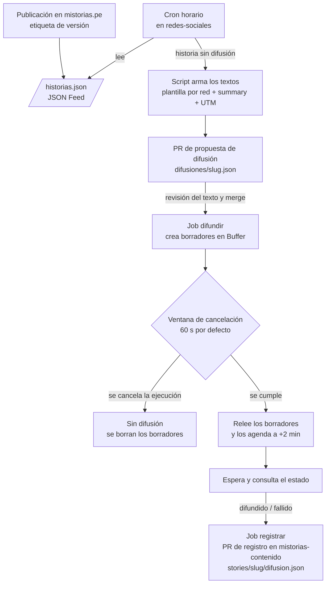

# ADR 0003: Flujo de difusión automática en redes sociales

## Estado

Aceptada.

Los términos en cursiva (_Difusión_, _Borrador_, _Autoaprobación de la
difusión_, etc.) se definen en [CONTEXT.md](../../CONTEXT.md).

## Contexto

Hasta ahora los posts de cada semana los armaba el skill `publicar-en-redes`
(gancho = `summary`, cierre por red, UTM) en una conversación con IA. Es trabajo
mecánico: aplicar reglas fijas a lo que ya está escrito en el contenido. Hacerlo
con IA gasta tokens en algo que un script resuelve igual cada vez, y deja el
resultado fuera del repositorio, sin revisión ni historial.

Restricciones:

- **Se difunde solo lo que ya está publicado.** Una historia sale en redes
  cuando ya está en mistorias.pe (su _Publicación_, en el sentido de
  mistorias-web), no cuando entra a `mistorias-contenido`: entre ese merge y la
  etiqueta de versión pueden pasar días, y un enlace a una página que todavía no
  existe es un 404 frente a la audiencia.
- **Difundir parte de una decisión humana y deja un margen para arrepentirse.**
  Hacer disponible la propuesta de difusión es el acto humano. Nadie hace clic
  para aprobar después: queda una _Ventana de cancelación_ en la que se puede
  frenar la difusión.
- **Principio de mínimo privilegio** (ver
  [ADR 0004](0004-credenciales-y-minimo-privilegio.md)): ninguna pieza recibe
  más permiso del que su tarea necesita.

## Decisión

El skill `publicar-en-redes` se reemplaza por scripts deterministas en este
repo, encadenados por GitHub Actions, con una revisión del texto y una
autoaprobación con ventana de cancelación:

1. **Disparador: el feed del sitio.** mistorias-web publica `/historias.json` en
   formato JSON Feed (su ADR 0033), generado en el build. Un cron horario de
   este repo lo lee por HTTP. Como es el feed del sitio en producción, si el
   despliegue falla no se difunde nada, y la web no necesita ninguna credencial
   hacia este repo. Se descartaron `repository_dispatch` desde el despliegue de
   la web (le daría a la web permiso de escritura sobre este repo) y leer los
   _deployments_ de GitHub (acopla el script a cómo despliega la web).
2. **Propuesta de difusión, sin IA.** Un script aplica plantillas fijas por red:
   el gancho es el `summary`, el cierre es el de cada red y el enlace lleva UTM
   (`utm_source=<red>&utm_medium=social&utm_campaign=<slug>`). Valida los
   límites de caracteres de cada red. El resultado queda en
   `difusiones/<slug>.json` y llega como **PR de propuesta de difusión**: ahí se
   revisa el texto y, si hace falta, se ajusta a mano. Si alguna vez una red
   necesita un texto que la plantilla no resuelve, se le puede pedir a Claude
   bajo demanda desde el PR; no es el camino por defecto.
3. **Borradores y ventana.** El merge de esa propuesta dispara el job
   `difundir`. Primero valida la configuración; luego crea un _Borrador_ por red
   en Buffer y deja en el resumen del job el enlace a cada uno, el enlace a la
   ejecución y la hora en que cierra la _Ventana de cancelación_. Todavía no se
   agenda nada.
4. **Autoaprobación o cancelación.** La ventana dura lo que diga la variable de
   repositorio `BROADCAST_CANCEL_WINDOW_SECONDS`, y 60 segundos si no existe o
   está vacía. Si no es un entero entre 10 y 3600, el job falla **antes** de
   tocar Buffer. Para **cancelar** se cancela la ejecución en Actions (_Cancel
   workflow_ o `gh run cancel`): un paso `if: cancelled()` borra los borradores
   y no sale nada. No hay job ni environment de aprobación. Quién hizo
   disponible la propuesta y quién canceló queda en el PR y en la ejecución, y
   no se agrega al registro.
5. **Agendar.** Cumplida la ventana, el mismo job **relee cada borrador** en
   Buffer, por si alguien lo editó ahí, y lo pasa a agendado para **dos minutos
   después**. No se usa el flujo de aprobación propio de Buffer: no está en el
   plan gratuito y la decisión ya ocurrió en GitHub.
6. **Confirmar y registrar.** El job espera esos dos minutos y consulta en
   Buffer el estado de cada post, con unos pocos reintentos hasta un tope de
   unos 15 minutos. Sube el resultado como artefacto y el job `registrar` (otro
   environment, otra credencial; ver
   [ADR 0004](0004-credenciales-y-minimo-privilegio.md)) abre el **PR de
   registro** en `mistorias-contenido`, con el _Registro de difusión_ en
   `stories/<slug>/difusion.json` (contrato en `docs/registro-de-difusion.md` de
   ese repo) y el estado `difundido` o `fallido`. Registra el texto releído de
   Buffer, que es el que salió. Si se canceló `difundir`, `registrar` no corre.
   Un fallo no se reintenta solo: queda registrado y a la vista.
7. **Sin duplicados.** El cron no abre una propuesta si ya existe
   `difusiones/<slug>.json` o un PR abierto para ese slug; por eso una difusión
   cancelada no se vuelve a proponer sola. Para difundirla después se vuelve a
   correr esa ejecución (_Re-run all jobs_). El job `difundir` no agenda en una
   red que ya tiene una entrada `difundido` en el registro.

## Consecuencias

- Difundir una historia no consume tokens de IA. Lo que cuesta revisar es el
  texto, en la propuesta.
- **Ya nadie hace clic.** Si se hace disponible la propuesta y no se mira, la
  difusión sale. La ventana es el único margen, por eso la propuesta no se
  fusiona sola (sin _auto-merge_) y la ventana no se acorta por debajo de 10
  segundos.
- El texto queda versionado dos veces, con propósitos distintos: la propuesta
  aprobada aquí (lo que se pidió difundir) y el registro en
  `mistorias-contenido` (lo que Buffer confirmó). Este repo sigue sin guardar el
  registro de difusión.
- **Sin verificar** (spike en
  [#11](https://github.com/mistorias/mistorias-redes-sociales/issues/11)):
  - La interfaz web de Buffer pasa un borrador a la cola (_Add to Queue_ /
    _Schedule Post_), pero no se confirmó que la **API** lo haga. Si no puede,
    el job `difundir` borra el borrador y crea el post agendado con el texto
    releído, y el `bufferId` que se registra es el del post final.
  - El paso `if: cancelled()` tras una cancelación manual tiene unos minutos de
    gracia en GitHub; hay que comprobarlo con una ejecución cancelada real. Si
    falla, los borradores quedan inertes (un borrador no se publica) y se borran
    a mano.
- mistorias-web tiene que publicar `/historias.json` y aceptar `difusion.json`
  dentro de la carpeta de una historia: hoy su gate de carpetas solo admite
  `principal.jpg` y rompería el build. Ese cambio va en mistorias-web y **se
  fusiona antes** que el primer registro.
- Consumo de la API: crear, releer y agendar cada borrador, más las consultas de
  estado, suman unas 20 llamadas por semana; muy por debajo de las 3000 cada 30
  días del plan gratuito.
- El job `difundir` ocupa la ventana más hasta 15 minutos de confirmación, sin
  costo en un repo público.
- La "pregunta de acción" que el skill construía en modo mayéutico deja de
  generarse cada semana: pasa a ser parte fija de la plantilla de cada red, y se
  cambia editando la plantilla.
