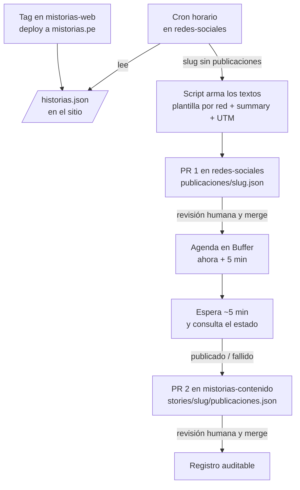

# ADR 0003: Flujo de publicación automática en redes sociales

## Estado

Aceptada.

## Contexto

Hasta ahora los posts de cada semana los armaba el skill `publicar-en-redes`
(gancho = `summary`, cierre por red, UTM) en una conversación con IA. Es trabajo
mecánico: aplicar reglas fijas a lo que ya está escrito en el contenido. Hacerlo
con IA gasta tokens en algo que un script resuelve igual cada vez, y deja el
resultado fuera del repositorio, sin revisión ni historial.

Restricciones:

- **Se anuncia solo lo que ya está publicado.** Una historia sale en redes
  cuando ya está en mistorias.pe, no cuando entra a `mistorias-contenido`: entre
  ese merge y el tag de mistorias-web pueden pasar días, y un enlace a una
  página que todavía no existe es un 404 frente a la audiencia.
- **Publicar sigue siendo una decisión humana**, igual que en mistorias-web
  (merge y tag nunca son automáticos). El texto se revisa antes de salir.
- **Principio de mínimo privilegio** (ver
  [ADR 0004](0004-credenciales-y-minimo-privilegio.md)): ninguna pieza recibe
  más permiso del que su tarea necesita.

## Decisión

El skill `publicar-en-redes` se reemplaza por scripts deterministas en este
repo, encadenados por GitHub Actions y con dos PRs de revisión humana:

1. **Disparador: el feed del sitio.** mistorias-web publica `/historias.json`
   (slug, título, `summary`, fecha, URL e imagen de cada historia), generado en
   el build. Un cron horario de este repo lo lee por HTTP. Como el feed es el
   del sitio en producción, si el deploy falla no se anuncia nada; y la web no
   necesita ninguna credencial hacia este repo. Se descartaron
   `repository_dispatch` desde el deploy de la web (le daría a la web permiso de
   escritura sobre este repo) y leer los _deployments_ de GitHub (acopla el
   script a cómo despliega la web).
2. **Textos sin IA.** Un script aplica plantillas fijas por red: el gancho es el
   `summary`, el cierre es el de cada red y el enlace lleva UTM
   (`utm_source=<red>&utm_medium=social&utm_campaign=<slug>`). Valida los
   límites de caracteres de cada red antes de abrir el PR. El resultado queda en
   `publicaciones/<slug>.json` y llega como **PR 1** en este repo: ahí se revisa
   y, si hace falta, se ajusta a mano. Si alguna vez una red necesita un texto
   que la plantilla no resuelve, se le puede pedir a Claude bajo demanda desde
   el PR; no es el camino por defecto.
3. **Agendar.** El merge del PR 1 a `main` dispara el Action que crea los posts
   en Buffer agendados para **cinco minutos después**: margen para cancelarlos
   desde Buffer si algo se vio mal tarde, sin que la publicación quede para otro
   día.
4. **Confirmar.** El mismo job espera esos cinco minutos y consulta en Buffer el
   estado de cada post, con unos pocos reintentos hasta un tope de unos 15
   minutos. Luego abre el **PR 2** en `mistorias-contenido` con el registro en
   `stories/<slug>/publicaciones.json` (contrato en
   `docs/registro-de-publicaciones.md` de ese repo), con estado `publicado` o
   `fallido`. Un fallo no se reintenta solo: queda registrado y a la vista.
5. **Sin duplicados.** El cron no abre un PR 1 si ya existe
   `publicaciones/<slug>.json` o un PR abierto para ese slug. El Action de
   agendar no crea un post para una red que ya tiene `bufferId` en el registro
   de contenido.

## Consecuencias

- Publicar una semana no consume tokens de IA. Lo que cuesta revisar es el
  texto, en el PR 1, no el armado.
- El texto que salió queda versionado dos veces con propósitos distintos: el
  borrador aprobado aquí (lo que se pidió publicar) y el registro en
  `mistorias-contenido` (lo que Buffer confirmó). Este repo sigue sin guardar el
  registro de lo publicado.
- mistorias-web tiene que publicar `/historias.json` y aceptar
  `publicaciones.json` dentro de la carpeta de una historia: hoy su gate de
  carpetas solo admite `principal.jpg` y rompería el build. Ese cambio va en
  mistorias-web y **se fusiona antes** que el primer registro.
- Consumo de la API: unas dos llamadas por post más las consultas de estado,
  cerca de 15 por semana; muy por debajo de las 3000 cada 30 días del plan
  gratuito.
- Un job que espera hasta 15 minutos ocupa minutos de GitHub Actions; en un repo
  público no tiene costo.
- La "pregunta de acción" que el skill construía en modo mayéutico deja de
  generarse cada semana: pasa a ser parte fija de la plantilla de cada red, y se
  cambia editando la plantilla.
